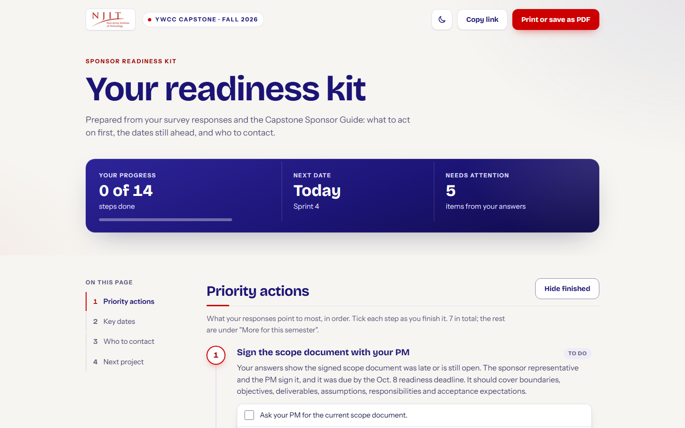
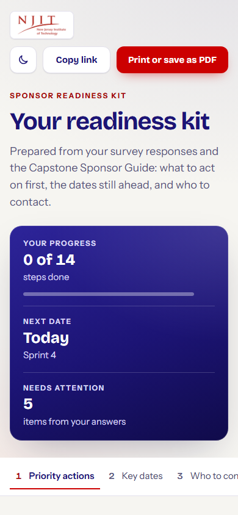

# Sponsor Readiness Kit

**A personal to-do list for every NJIT capstone sponsor.** When a sponsor finishes the [Sponsor Experience Survey](https://slyguy7.github.io/sponsor-survey/), this page turns their answers into a readiness kit: what to act on first, the dates still ahead, who to contact and reference material for their next project.

[](https://github.com/SlyGuy7/sponsor-kit/actions/workflows/test.yml)

**Live site:** https://slyguy7.github.io/sponsor-kit/ (it needs the link from the end of the survey to show a kit)

<picture>
  <source media="(prefers-color-scheme: dark)" srcset="docs/screenshots/kit-dark.png">
  
</picture>

## Highlights

- **Built from the sponsor's own answers.** Priority actions come first, as numbered steps with tick boxes and a To do / In progress / Done status.
- **Nothing is sent anywhere.** The answers travel as short option codes after the `#` in the address, which browsers never send to a server. They contain no names, emails or free text. Ticks are saved only in that browser.
- **Dates with countdowns** and **Add to calendar** buttons, plus a banner in the two days before the Final Capstone Showcase.
- **Easy to share and keep:** Copy link (Share on phones), Email this to my PM, and Print or save as PDF with a QR code that reopens the kit.
- **Same look as the survey,** with light and dark mode, accessibility checks and layouts down to a 320px-wide phone.

| On a phone |
| --- |
|  |

## Built by

The Fall 2026 NJIT YWCC Capstone Operations Team: **Eugene Amparbeng, Mariah Torres, Gerard Herrera and Steven Vernikov**.

---

# Maintainer guide

## What the kit shows

- **Priority actions** as numbered steps. Each step has tick boxes, a status, and the header shows overall progress. Ticks are saved only in that browser (localStorage, one set per kit link) and are never sent anywhere.
- **Key dates** still ahead, each with a countdown, and **Add to calendar** buttons that download `.ics` files. In the two days before the Final Capstone Showcase, a banner at the top gives its time and place.
- **Who to contact**, and reference material for the next project (the items the sponsor picked come first and open).
- **Copy link** (on phones and tablets, **Share**, which opens the device's share sheet) and **Print or save as PDF**, which opens every section first. The printout carries the date, the link and a QR code that reopens the kit on a phone.
- Sharing and tools: **Email this to my PM** on each action, **Copy my action list**, **Clear all ticks**, **Hide finished**, **Expand all**, **Copy text** on reference items and **Copy** next to emails.
- **Updated since your last visit**: when the guide content (`readiness.json`) changes, a returning sponsor sees which actions, dates or items changed. Only a fingerprint of the content is stored, never answers.
- A **light/dark button** (stored as `njit-sponsor-theme`; it applies to the kit and its 404 page, while the survey follows the device setting) and a **link preview card** (`assets/og.png`) for Teams, Slack and email.

Without a valid link the page explains that and links back to the survey.

## Files

- `index.html`, `assets/kit.css`, `assets/kit.js`, `assets/theme.js`: the page. Colours, shadows and fonts are tokens at the top of `kit.css`, with the dark values just below, matching the survey's `style.css`.
- `404.html`: shown by GitHub Pages for any address that does not exist.
- `assets/engine.js`: the rules and the link decoder. Based on `assets/readiness.js` in the survey repository, without its renderer.
- `assets/qr.js`: a small QR code encoder written for this site (byte mode, level M, versions 1 to 10). `tests/qr.test.js` checks it against the QR standard's worked examples and reads every generated code back.
- `assets/survey.json`, `assets/readiness.json`: **exact copies** of the same files in the survey repository.
- `scripts/stamp.js`: adds version tags to file links (see "Publishing an update").
- `check-sync.js`: compares the two copies with the live survey site.
- `check-dates.js`: warns when the last key date is two weeks away and fails once every date has passed.
- `serve.js`: a small local server for trying the page and for the tests. It tells the browser not to cache, so a reload always shows your latest edits.
- `docs/screenshots/`: the images in this README.

## Publishing an update

After changing any file in `assets/` (or `index.html`, `404.html`), run:

```
npm run stamp
```

This gives each script, stylesheet and data file a version tag taken from its contents (`kit.css?v=eca2451f0c`). GitHub Pages lets browsers keep files for about 10 minutes, so without the tags a visitor could get the new page with an old script. With them, every visitor gets a matching set. `npm test` (and the Tests workflow) fails with "Run: npm run stamp" if a tag is out of date.

`main` is protected: changes go in through a pull request, and it can only be merged once the **test** check passes. GitHub Pages then publishes `main` within a few minutes.

## Keeping in step with the survey

A kit link stores the position of each chosen option, not its text. If the survey's questions or options change and the copies here do not, links from the survey are read wrong without any error message.

When the survey changes:

1. Copy `assets/survey.json` and `assets/readiness.json` from the survey repository into `assets/` here, unchanged.
2. If the survey's `assets/readiness.js` changed its `build`, `encode` or `decode` functions, make the same change in `assets/engine.js`.
3. If the survey raised its kit-link `VERSION` (in `readiness.js`), raise `VERSION` in `assets/engine.js` to match.
4. Run `npm run stamp`, then `npm test`.
5. Merge the survey's pull request first, then this one right after. `npm run check:sync` (should print `ok` twice) confirms the copies match the live survey.

The **survey-sync** job in GitHub Actions runs the same check on every push and every Monday, and turns red when the copies are out of date. It is not a required check, so it never blocks merging the kit update that fixes it.

## Each new semester

The key dates come from `dates` in `readiness.json` (edited in the survey repository). After the last one passes, every kit shows no dates.

The **survey-sync** job also runs `npm run check:dates` every Monday. It shows a warning in the two weeks before the last date and fails once they have all passed. GitHub emails the repository owner when a scheduled run fails, so that email is the reminder. To fix it, add the new semester's dates in the survey repository, then copy `readiness.json` here as above.

## Run it locally

```
npm install
npm run serve
```

Then open `http://127.0.0.1:4173/` with a `#kit=` link from the survey on the end.

## Run the tests

```
npm install
npx playwright install chromium
npm test
```

## Publish

Repository settings > Pages > deploy from the `main` branch, root folder. The address is `https://slyguy7.github.io/sponsor-kit/`.
